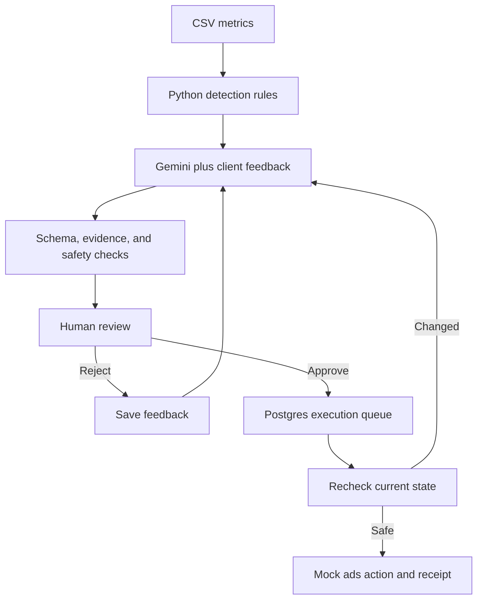

# Ad Budget Guardian

A command-line agent using Google Gemini to recommend advertising changes. Python calculates metrics and enforces safety rules; a human approves or rejects each recommendation. Postgres stores the queue and history.

Gemini is the only runtime model. The assignment’s CSV metrics and persistent **mock ads API** remain: approved actions change simulated accounts, not real Google/Meta accounts.

## Start from a clone

Requires Git, Docker with Compose v2, and a Gemini API key. If `docker --version` fails, install and start Docker Desktop, or use the local setup in [DEVELOPER_GUIDE.md](DEVELOPER_GUIDE.md#local-setup-without-docker). With Docker running, the first Gemini run takes five commands:

```sh
git clone <your-repository-url> ad-budget-guardian
cd ad-budget-guardian
export GEMINI_API_KEY='<your-key>'
docker compose up -d --wait postgres
docker compose run --build --rm app run-daily --date 2026-11-09 --client C1
```

Migrations and starting clients/budgets are created automatically. The supplied metrics end on November 9, 2026. Omit `--client C1` to process all clients. To keep the key for later sessions, copy [.env.example](.env.example) to `.env` and set `GEMINI_API_KEY` there. After the first build, run `alias guardian='docker compose run --rm app'` for short commands in that terminal. Rebuild the image after code changes.

On Sunil’s existing local installation, keep the current `.env` and run:

```sh
cd /Users/sunil3582/Diligent
unalias guardian 2>/dev/null
source .venv/bin/activate
guardian run-daily --date 2026-11-09 --client C1
```

## Review and execute

Replace `<id>` with an actual proposal UUID, without angle brackets.

```sh
guardian proposals list --status pending_approval
guardian proposals show <id>
guardian llm-calls --proposal <id>
```

`show` contains the proposed action, reason, evidence, and safety result. New budget shifts also have `amount_rationale`: Gemini's explanation for the exact daily INR transfer, separate from its reason for changing the ad. The explanation appears in the approval email draft too. Older saved proposals may lack it. `llm-calls` records Gemini calls and their outcomes. A model name alone does not prove success: inspect `decision` for validated proposals/abstentions or `invalid_or_failed`.

Choose **one** review decision:

```sh
guardian approve <id> --reviewer sunil
# OR
guardian reject <id> --reviewer sunil --reason 'Keep this campaign active; prefer a creative refresh.'
```

Rejection closes the proposal without changing an ad. The reason provides context for future recommendations for that client—for example, a planned sale may make a pause inappropriate.

```sh
guardian execute-approved --client C1
guardian mock changes AS-102
```

`execute-approved` processes approved/retryable work and rechecks budgets, metrics, and policy. A manual edit makes an old proposal stale; a replacement needs new approval. `mock changes` shows simulated platform changes; use the ad-set ID from your proposal. Creative refreshes queue work requests, not new assets.

## Architecture



Repeated completed client/date runs skip recommendation generation, but still process previously approved work. New daily runs need new metrics. Use `guardian runs` for checkpoints and `guardian mock show` for current simulated budgets.

## Rules and safety decisions

The seven-day window is D−6 through D. CPA is total spend divided by conversions, ROAS is total revenue divided by spend, and CTR is total clicks divided by impressions. At least **five observed days and a row on D** are required; missing days are not treated as zero. Underperformance requires **CPA > 120% of the client's target and ROAS < 80% of its target**. With zero conversions, positive spend of at least twice target CPA can satisfy the CPA side of that rule. Fatigue requires a late-window mean frequency of **at least 3**, a rise of **at least 15%**, and a CTR fall of **at least 20%** versus the early segment. Exact underperformance boundaries are not flagged.

Gemini receives only Python-flagged ad sets and returns JSON matching a schema. For each new budget shift, it must explain its chosen amount and name that amount in INR; a missing explanation triggers a retry. This is a model rationale for a human to assess, not proof that the amount is optimal. Code separately checks ownership, active status, data sufficiency, the client's maximum shift percentage, healthy destinations, nonnegative budgets, and the client's total daily cap. Unsafe proposals are stored as `blocked` with reasons. Approval never edits the saved action; execution checks current metrics, budget, status, revision, and policy again. Postgres keeps reviews and receipts so retries cannot apply the same approved action twice. This design uses SQL for recent rejection context instead of a vector database or agent framework.

An observed **live Gemini example on fabricated data** shows the rejection path: Gemini first proposed a ₹200 daily shift from an underperforming source to a healthy recipient. A reviewer rejected it with “keep this launch active without budget changes; recommend a creative refresh instead.” On the next synthetic day, Gemini proposed `creative_refresh` with zero budget change and referred to that preference in its reason. Both proposals passed validation and stayed pending; none executed. The agent retrieves up to five rejections from the same client within the last 90 days, prioritizing relevant ad sets. This guides Gemini but does not guarantee that it will never suggest a similar action again. An enforceable permanent preference would need an explicit structured policy checked in code.

## Test and schedule

```sh
make eval
make check
```

Tests use real Postgres in a separate `guardian_eval` database and fixed responses confined to `tests/`. Each case names its input and expected result; `make eval` prints PASS/FAIL for each and an overall score. Cases that depend on model output score schema handling, exact evidence, policy checks, state transitions, and platform effects rather than matching prose. Fixed responses make the suite repeatable and do not spend Gemini quota. Live-model quality needs separate checks. The latest terminal summary is:

```text
Overall: 74/74 (100.0%)
============================= 74 passed in 47.96s ==============================
```

If a prompt change raises the eval pass rate from 62% to 65%, I would not ship based on that number alone. I would compare the same held-out cases, repeat model-dependent cases to estimate variation, inspect which cases improved or regressed, and check cost and latency. Any safety regression blocks release. I would ship only if the improvement repeats without important regressions and I can revert the prompt and model version if needed.

For daily operation, keep `.env` configured and provide fresh CSV metrics. `guardian run-daily` processes yesterday in `BUSINESS_TIMEZONE`. Schedule at 09:00 in the host’s timezone:

```cron
0 9 * * * /bin/sh /absolute/path/ad-budget-guardian/scripts/run-daily.sh >> /absolute/path/guardian.log 2>&1
```

The script uses the local environment when available, otherwise Docker. Postgres must be running. Docker state survives `docker compose down`.

The supplied CSV has historical dates, so the scheduler needs new metrics added for future dates; otherwise it reports `no_data`. The mock platform stores state across restarts, but does not connect to real advertising accounts or deploy creative assets. Docker packaging has not been verified on this development host because Docker is not installed here; local Postgres runs and tests have been verified.

With another week, I would add a real metrics feed, authenticated reviewer identities, provider-side reconciliation for partial failures, and repeated live Gemini evals on held-out cases. I would keep the same approval and code-guardrail boundaries.

